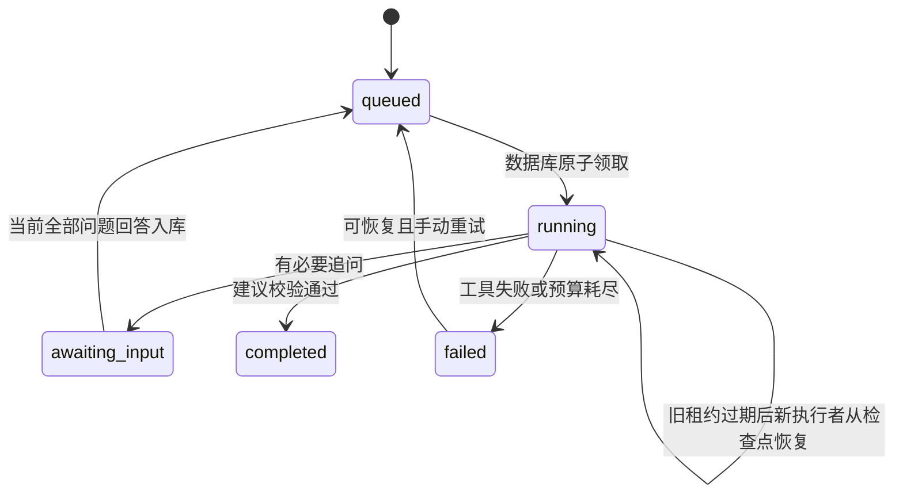

# Agent 工作流

本实现为**固定安全阶段、结构化工具动作与dispatcher**。模型决定岗位要求、证据覆盖及是否需要追问；服务端决定合法阶段、调用预算与可写字段。不是模型自由选择任意工具，也未使用原生function/tool calling。

| 阶段 | 工具 | 执行与检查 |
|---|---|---|
| 0 | extract_job_requirements | 模型提取最多20项要求；JD引用必须逐字存在、ID唯一 |
| 1 | find_resume_evidence | 模型从快照字段目录匹配证据；覆盖每项要求；决定0—3题追问 |
| 2 | request_clarification | 本地工具保存追问并结束执行；最多一轮，无问题则跳过等待 |
| 3 | draft_resume_changes | 模型基于保存证据/回答生成最多20项局部修改；先验证再放入对外视图 |
| 4 | validate_changes | 本地再次验证字段、目标ID、before、类型、来源和数字，完成任务 |

上下文控制：JD最多12000字符、整个快照最多48000字符、每字段4000字符、回答每题2000字符；HTTP体最多128KiB。超长输入拒绝，避免静默截断原文后出现伪引用。岗位提取仅给JD，匹配给要求和按ID定位的字段目录，建议阶段给快照/要求/证据/回答。模型输出限制3500 tokens、接收体限制256KiB，JSON/schema至多修复一次。

JD、简历、回答均放在user数据消息；system固定规则禁止改变权限或把JD当候选人事实。源引用由本地重新验证，不相信模型自报来源。拒绝无来源的新数字；所有合法建议仍强制needsConfirmation=true。此方法不能证明语义绝无幻觉或抵御全部提示注入，需要用户确认和失败案例验收。

本地脚本轨迹（合成输入、可控provider，**不是实际模型轨迹**）：岗位解析 → 模糊证据 → 持久化追问/awaiting_input → 提交回答 → 领取同一任务 → 建议与规则验证 → completed。集成测试验证前两步不重复执行、共3个模拟上游请求、5个工具步骤。原始记录在results/local-tests.tap.txt。

真实轨迹待有实际模型和Supabase后运行smoke取得；不能用本段或agent.examples.ts替代真实Demo证据。
