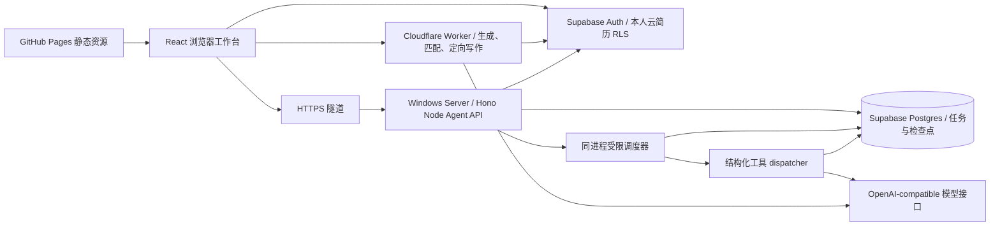

# Agent 架构与实现边界

核对日期：2026-10-25。当前线上采用分离服务，部署步骤见 [生产部署](../../deploy/production.md)。Docker Compose 是可选方案，不代表线上运行了 Caddy、Nginx 或 Kubernetes。

一个进程同时承载 HTTP 和调度器，减少运维组件。创建先写数据库再返回 202；调度器只领取已保存任务。浏览器刷新通过 runId 恢复，不持有执行权。Worker 短请求与 Agent 持久任务分别发布，前端 push 不会更新这两套后端。

数据库：agent_runs存快照、视图和阶段；agent_operations存操作幂等；agent_steps存真实步骤状态；agent_answers存一轮回答；agent_model_calls存每次预留调用和用量。迁移仅新增对象。服务角色绕过RLS，因此所有用户接口仍显式绑定认证所得owner；RPC对anon/authenticated禁用，浏览器只能读自己的任务/步骤/回答，不能直接写任务。

默认单实例、并发2。数据库领取事务用全局 advisory lock限制多个进程总并发；每任务90秒租约、15秒续租。检查点和模型日志写入必须同时匹配租约token、未过期和running状态，过期执行者不能提交。横向扩展前仍需实际压测数据库连接、RPC延迟、模型配额及资源，不以租约实现等同已验证大规模扩容。

前端工作区已包含证据、追问、原文对比、选择应用与撤销。经历库与岗位记录保存在当前浏览器，不会自动跨设备同步；云端简历是单独的 Supabase 功能。使用 JSON 结构化动作和服务端 dispatcher，未采用原生 function calling。

验证包括本地 SQL/HTTP/可控故障测试、真实 Supabase 鉴权与租约检查，以及公网真实 Auth/模型任务，见 [发布验收](split-services-release.md) 和 [成本性能](cost-performance.md)。各报告保留自己的提交与测试条件。真实 API 强杀恢复、多实例竞争和负载资源仍待专项测试；没有用户节时或录用效果结论。未使用 RAG、多 Agent 或 K8s。
