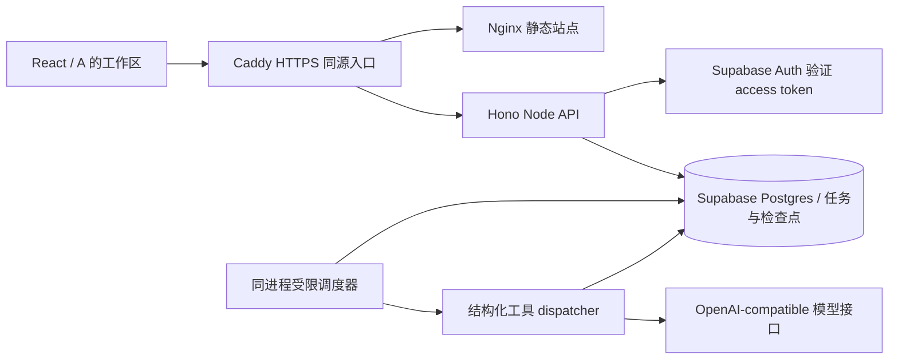

# Agent 架构与实现边界

基线：8878fc82eaea880fcbe0183f461a4fbdb2da4a65。新增服务与原Workers独立；原React/简历编辑/导出保留。

一个进程同时承载HTTP和调度器，降低两人赛期部署复杂度。创建先写数据库再202；调度器只领取已保存任务。浏览器刷新通过runId恢复，不持有执行权。

数据库：agent_runs存快照、视图和阶段；agent_operations存操作幂等；agent_steps存真实步骤状态；agent_answers存一轮回答；agent_model_calls存每次预留调用和用量。迁移仅新增对象。服务角色绕过RLS，因此所有用户接口仍显式绑定认证所得owner；RPC对anon/authenticated禁用，浏览器只能读自己的任务/步骤/回答，不能直接写任务。

默认单实例、并发2。数据库领取事务用全局 advisory lock限制多个进程总并发；每任务90秒租约、15秒续租。检查点和模型日志写入必须同时匹配租约token、未过期和running状态，过期执行者不能提交。横向扩展前仍需实际压测数据库连接、RPC延迟、模型配额及资源，不以租约实现等同已验证大规模扩容。

实现：共享协议、四接口、任务幂等与限制、工具流水线、追问暂停、结构化输出、规则校验、预算、检查点/租约、容器/CI配置、真实测量脚本。前端工作区/写回由A负责，本改动不实现它们。

验证范围：本地SQL/HTTP/可控模型故障测试，以及实际测试Supabase的40项Auth/PostgREST/RLS/幂等/租约/检查点检查；报告在results。真实检查用临时合成账号和任务，结束后清理，不发送模型请求，也不领取全局其他用户任务。当前部署在本机8788，无云主机；尚待DeepSeek模型能力、完整任务/进程恢复、A端到端及后续公网HTTPS入口验收。无真实模型费用/延迟结论。无RAG、多Agent、K8s或新增面试功能。
